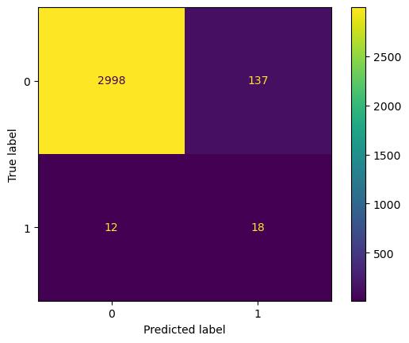
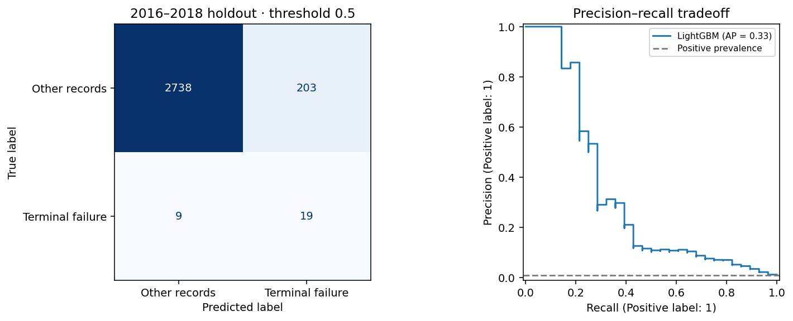
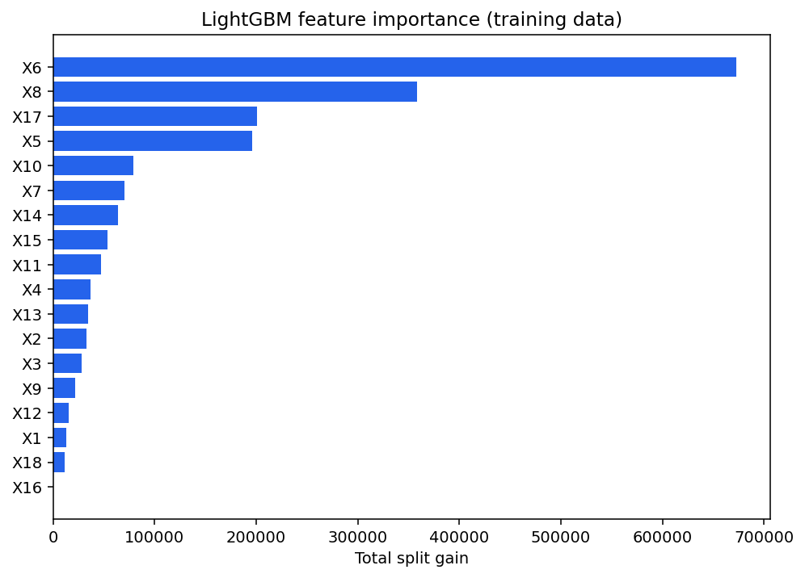

# LightGBM for Small-Cap Bankruptcy Prediction in the United States

**Exploring rare-event classification with financial data, gradient-boosted trees, and chronological evaluation.**

Python · LightGBM · Optuna · scikit-learn · imbalanced-learn · pandas

An individual **AP Research project by Aarav Singhvi**, accompanied by a 25-page research paper. The original work explored financial features, selected a small-cap company cohort, constructed row-level labels, applied SMOTE, and tuned a LightGBM classifier. This repository packages that experiment alongside a revised evaluation workflow prepared during repository cleanup.

The dataset contains **78,682 firm-year observations from 1999–2018**. The modeled target is a **retrospective proxy**: the final observed record of a company labelled failed. Exact bankruptcy-event and reporting dates are not available in the supplied CSV, so this is not a validated one-year-ahead forecasting system.

[Read the research paper](paper/AP-Research-Final-Paper.pdf) · [Original research notebook](bankruptcy_prediction.ipynb) · [Validation extension](validation_revision.ipynb) · [Data source](DATA.md)

## Research question and reported findings

The paper asks how effectively LightGBM can identify bankruptcy among U.S. small-cap companies. The original experiment prioritized recall because its proposed screening use case treated missed failures as more costly than false alarms. That is the study's stated motivation; investment returns and avoided losses were not empirically tested.

In the original saved experiment, the tuned model identified **18 of 30 positive records (60% recall)**, but produced **137 false positives (11.6% precision)**. Its **95.3% accuracy** was below the **99.1% accuracy** of always predicting the negative class. Detecting rare positives therefore comes with a substantial false-alarm tradeoff.

The tuned model caught three more positive cases than the baseline, increasing recall from 50% to 60% while adding 48 false alarms. The paper discusses this tradeoff explicitly.



These are historical outputs, not freshly reproduced results. The original workflow resampled before cross-validation, used company-ordered rows for `TimeSeriesSplit`, and explored features before separating the holdout. Its reported cross-validation scores are not reliable estimates of chronological generalization. Saved notebook cells were also executed out of order. See [the historical metrics record](results/original_metrics.json).

## Separate validation extension

The independently executed extension used **30 tuning trials** and selected the tuned model by development average precision. It trained on **21,144 original rows** (including 122 positives), then evaluated **2,969 later records**, including **28 positives**.

- **Recall:** 67.9% (19 of 28 positive records detected).
- **Precision:** 8.6% (203 false positives).
- **Accuracy:** 92.9%; always-negative baseline: 99.1%.
- **Average precision:** 0.328; positive prevalence: 0.94%.
- **ROC AUC:** 0.912, computed from prediction scores.
- **Decision threshold:** 0.5; no tuning on the holdout.

See [the recorded extension metrics](results/revised_metrics.json) for fold scores, parameters, data fingerprint, and package versions.



These results use a changed cohort and evaluation protocol and are **not a controlled comparison** with the original scores. The 2016–2018 holdout had already been examined in the original project; it is not new external validation.

## What the revised workflow does

1. **Validate the data.** Check column names, finite values, unique company/year rows, and company-level status consistency; explicitly sort records before defining targets.
2. **Select companies from training history.** Retain the original bounds of 250–2,000 for median `X8`, but compute that median only through each training cutoff. Later values cannot change which companies are selected for that fold.
3. **Validate in calendar order.** Use five expanding windows ending in 2007, 2009, 2011, 2013, and 2015. A year never crosses the training/validation boundary.
4. **Keep transformations inside each fold.** Fit scaling and SMOTE on training rows only. Validation and test data retain their natural class imbalance. Scaling makes the feature distances used by SMOTE less dependent on differing financial units.
5. **Select without the holdout.** Run 30 seeded Optuna trials, maximizing mean validation average precision. Compare with a fixed LightGBM baseline and select the better development score. Evaluate the selected model on 2016–2018 at a fixed threshold of 0.5.
6. **Report more than accuracy.** Save precision, recall, F1, average precision, probability-score ROC AUC, and confusion-matrix counts. Retain all 18 features rather than reusing full-data feature selection.



Feature importance describes model behavior, not causal effects. The financial variables retain the source dataset's `X1`–`X18` identifiers; consult the exact source version for their definitions.

## Run locally

Download `american_bankruptcy.csv` from the [Kaggle source](https://www.kaggle.com/code/utkarshx27/us-company-bankruptcy-prediction-93-accuracy/input) and put it in `data/`. See [DATA.md](DATA.md) for the tested file's fingerprint and schema.

From the repository root:

```bash
python -m venv .venv
source .venv/bin/activate
python -m pip install -r requirements.txt
python train.py --data data/american_bankruptcy.csv --trials 30
```

For Windows PowerShell, activate with `.venv\Scripts\Activate.ps1`. The checked run used Python 3.14.3 and the versions pinned in `requirements.txt`; installation in a fresh environment or on another operating system has not been tested.

To use the notebook interface:

```bash
python -m pip install jupyterlab
python -m jupyterlab bankruptcy_prediction.ipynb
```

The historical notebook preserves the paper's workflow. To run the extension interactively, open `validation_revision.ipynb` instead; that notebook and the command-line run share `train.py`. The revised run uses one LightGBM thread and fixed model, SMOTE, and Optuna seeds. Exact reproducibility can still vary across platforms and library versions.

### Outputs

Each run writes to `artifacts/` by default:

- `metrics.json`: configuration, cohort counts, validation scores, selected parameters, environment versions, and holdout metrics.
- `trials.csv`: tuning history.
- `predictions.csv`: row identifiers, targets, prediction scores, and decisions.
- `lightgbm.txt` and `scaler.npz`: model weights and the fitted scaling transformation; inference requires both.
- `evaluation.png` and `feature_importance.png`: result figures.

Generated artifacts and the raw CSV are ignored by Git. The small `results/` snapshots and `assets/` figures document the checked run; they are not automatically overwritten by later runs.

Run the protocol checks with:

```bash
python -m unittest discover -s tests -v
```

## Scope and limitations

- The terminal-record target is inferred from the dataset's complete history. Label availability at a historical cutoff and the intended forecast horizon are not independently verified.
- The original notebook interprets `X8` as market value. The exact source version's units must be checked before treating the numeric filter as a formal small-cap definition.
- Companies can appear in both training and later evaluation years. The model is not tested on entirely unseen companies, and observations within a company are dependent.
- Positive examples are sparse. A single seed and a small positive holdout do not establish stable population performance or uncertainty bounds.
- SMOTE creates synthetic financial combinations. Scores after oversampling are not calibrated bankruptcy probabilities, and the fixed threshold has not been optimized for real-world costs.
- The CSV alone does not establish when financial statements became available, so calendar separation is insufficient to claim a fully point-in-time forecasting backtest.

## Project provenance

The supplied `preprocessing.ipynb` and AP Research paper are the sources of the original study. Both originals remain unchanged. `bankruptcy_prediction.ipynb` is a presentation copy with a portable data path, explanatory sections, local warning paths removed, and the failed optional Graphviz plot omitted. Its saved model outputs were retained. The PDF is included byte-for-byte as supplied.

`train.py` and `validation_revision.ipynb` are a separate evaluation extension, including changes to preprocessing, cohort selection, validation, and tuning objective. They are not the exact code behind the paper or historical resume metrics. See [METHODS-NOTES.md](METHODS-NOTES.md) for the distinctions.

Dataset source: [Kaggle notebook input page supplied by the author](https://www.kaggle.com/code/utkarshx27/us-company-bankruptcy-prediction-93-accuracy/input). The CSV is downloaded separately and is not included in the repository.

Method references: [imbalanced-learn's resampling leakage guidance](https://imbalanced-learn.org/stable/common_pitfalls.html), [scikit-learn's time-series split documentation](https://scikit-learn.org/stable/modules/generated/sklearn.model_selection.TimeSeriesSplit.html), and [ROC AUC documentation](https://scikit-learn.org/stable/modules/generated/sklearn.metrics.roc_auc_score.html).
